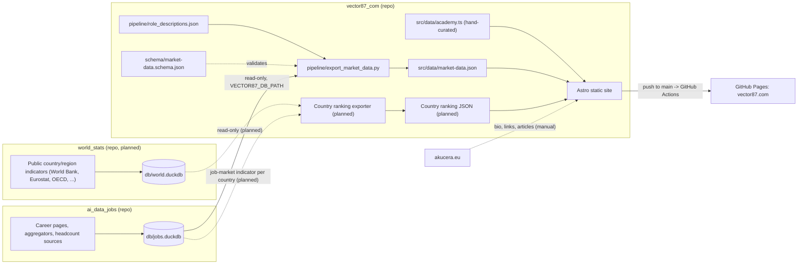

# Architecture — what feeds Vector87

Single source of truth for how repositories and data flow into the Vector87.com website.
Internal details of each upstream repo are documented in that repo — this file only describes the connections.

## Overview

Solid lines exist today; dashed lines are planned or manual.

## Responsibilities

| What | Where | Why |
|---|---|---|
| Job postings: scraping, transform, DuckDB `db/jobs.duckdb` | `ai_data_jobs` — model in its `docs/data-model.md` and `db/schema.sql` | that is where job data is produced |
| Country/region indicators, DuckDB `db/world.duckdb` | `world_stats` — scope and sources in its `AGENTS.md` | different domain and cadence than job scraping |
| JSON contracts (JSON Schema) | `vector87_com/schema/` | the frontend defines what it expects |
| Exporters DuckDB -> JSON | `vector87_com/pipeline/`, DB path from env var, DB opened read-only | contract + exporter + consumer in one place |
| Combining job data with country indicators | the Vector87 exporter, not either data repo | neither data repo depends on the other |
| Composite country score (weights) | Vector87 frontend | weights can change, and readers can adjust them, without re-running pipelines |
| Generated JSON | committed in `vector87_com/src/data/` | GitHub Pages CI cannot reach the local DuckDB files |
| Agent instructions | each repo has its own `AGENTS.md` and references, not copies, the others | single source of truth |

## Refresh cycle (today)
1. Run the `ai_data_jobs` pipeline locally (see its docs).
2. In `vector87_com`: `npm run export:data` — reads `jobs.duckdb` read-only, merges `role_descriptions.json`,
   validates against the schema, writes `src/data/market-data.json`.
3. Commit the JSON and push to `main`; `.github/workflows/deploy.yml` builds Astro and deploys to GitHub Pages.
   CI only builds — it never touches the databases.
